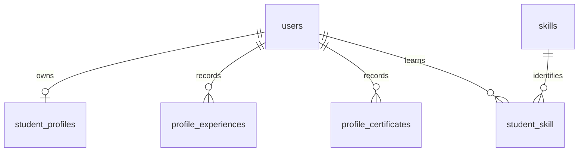
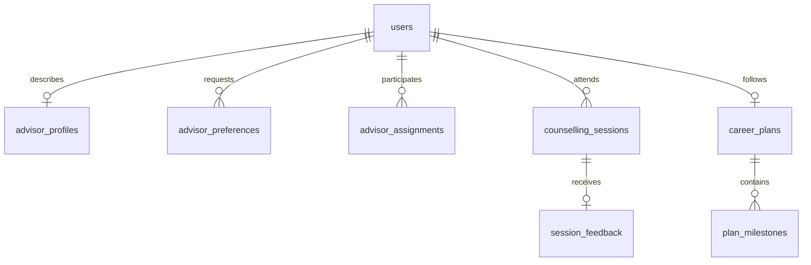
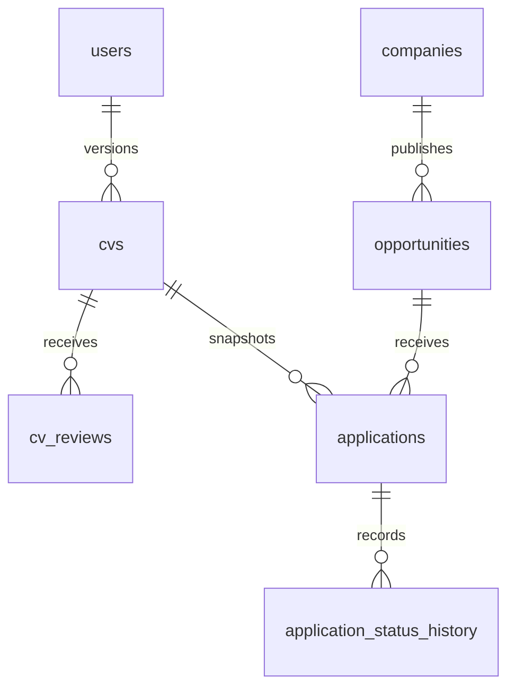
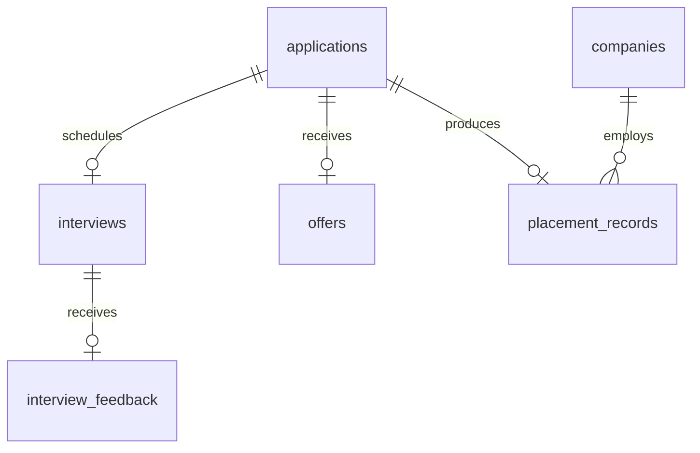

# Database foundations — Step 4

The schema is deliberately additive; compatibility columns are explained in DECISIONS.md. Steps 1–10 workflows are implemented; notifications/reminders/reporting support tables do not imply Steps 11–12 completion.

## Identity and profile

## Advising foundations

## CV and application foundations

## Recruitment foundations

## Supporting data
- `advisor_expertise`: advisor + tag unique.
- `opportunity_skill`: opportunity + skill unique.
- `saved_opportunities`: user + opportunity unique.
- `advisor_notes`: advisor and student, private flag; legacy `notes` retained.
- `reminders`: user and morph target.
- Laravel `notifications`: UUID + notifiable morph; legacy `alerts` retained.
- `audit_logs`: actor and indexed entity; Step 5 verification writes its decisions.
- `settings`: unique key.
- Framework tables: sessions, cache/cache_locks, jobs/job_batches/failed_jobs, password_reset_tokens, migrations and retained personal_access_tokens.

One active advisor per student: unique `active_student_id`, generated as the student ID only for active assignments. CV owner/version and application student/opportunity pairs are unique. One interview record per application is rescheduled in place; one offer and one placement per application.

## Notification delivery additions

notification_events stores unique per-recipient event keys for scheduler idempotency. reminders adds title and interval_days to its existing application reference and timing fields. users.avatar_path points to a private local file. No new public photo URL is stored.
